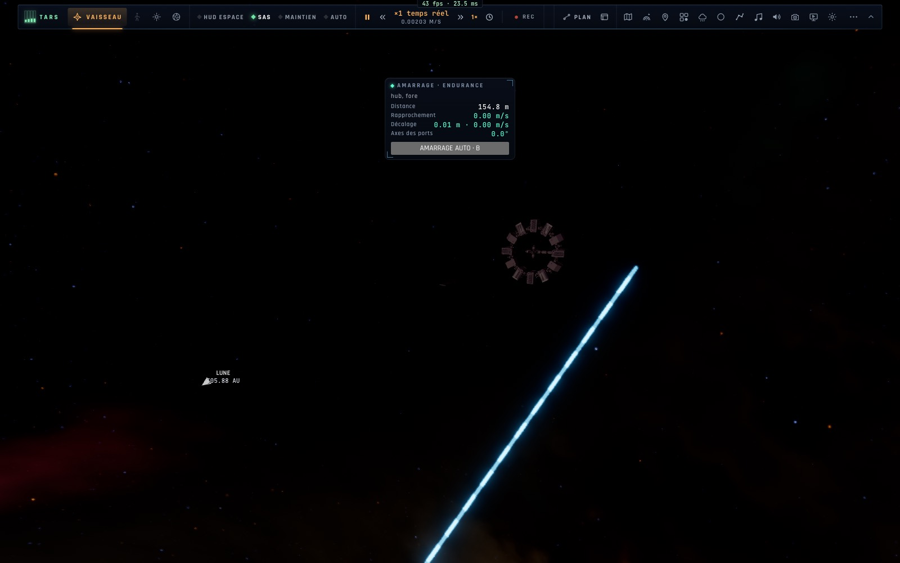

# X2c — L'Endurance vaisseau-mère près de Gargantua : à sa vraie taille, amarrable, l'autopilote d'amarrage

*2026-10-18, branche `vaisseaux-aaa` — `docs/PLAN-VAISSEAUX-AAA.md`, phase X2.*

Côté Gargantua, l'Endurance n'était qu'un décor (dessiné à l'échelle cinématographique, sans physique, sans ports). Elle
devient un vaisseau-mère comme l'ISS de notre côté (`controller/holeendurance.ts`) :

- **Son orbite** : celle de la scène (`endurance.ts` `endurancePose`), exacte — dans le **plan équatorial** de Gargantua,
  où son cercle est une géodésique de Kerr (Ω = 1/(r^3/2 + a)) : un vaisseau à côté y reste à côté (0,85 m en 60 s).
  Inclinée, la scène dessine toujours l'Endurance mais elle n'est pas amarrable : son cercle incliné n'est pas une
  géodésique (mesuré : 27 m/s d'écart dès le premier cinquième de seconde).
- **À moins de 60 km**, le vrai modèle (64 m) est dessiné comme un vaisseau, le décor cinématographique masqué
  (`holefleet.ts`, `renderer.ts holeShips`).
- **L'amarrage** : le panneau d'amarrage (distance, rapprochement, décalage, axes des ports) mesuré dans le repère au
  repos de la caméra ; la capture aux mêmes limites que la station ; **tenu au port** pendant que l'orbite emporte
  l'ensemble ; DÉSAMARRER sur les ressorts (5 cm/s).
- **B, l'autopilote d'amarrage** près de Gargantua : vers l'axe du port, puis le couloir (le profil nominal, 0,1 m/s au
  contact), l'attitude du vaisseau amarré tenue.
- **La scène « Gargantua : le Ranger près de l'Endurance »** : le monde de jeu de Gargantua (10⁸ M☉, moteur réaliste),
  le Ranger à 150 m du port avant, à sa vitesse (0,24 c autour du trou).

## Trois pièges trouvés et réglés

1. Le moteur « Cinéma » hérité d'un preset (des milliers de g : le RCS y vaut 1 000 m/s²) → la scène prend le moteur
   réaliste du jeu.
2. La masse par défaut (6,5·10⁹ M☉) alors que les unités de temps supposent 10⁸ M☉ : le « temps réel » y courait 65 fois
   trop vite → la scène est bâtie sur le monde de jeu de Gargantua.
3. L'horloge : hors du pas de simulation, `nowTime()` est le début du pas (une image de retard) — à 0,24 c, des milliers
   de km ; le rendu et le placement lisent l'horloge de la vue, et la scène place le Ranger deux images après le
   chargement.

## Mesures

`tests/hole-endurance.test.ts` (3/3) : placé à 150 m (154,8 m au repos, 3 % de plus à 0,24 c), il y reste (155,7 m après
60 s) ; rapproché au RCS : capturé à 0,22 m/s, tenu 30 s, désamarré à −0,050 m/s ; **B depuis 150 m : APPROCHE → FINALE,
amarré à 0,09 m/s en 266 s**. Tests voisins (amarrage en vrille, maintien à poste, protections, assistance, flotte,
ergols, anneau, i18n) : 37/37. En jeu (headless) : le vrai modèle à côté du Ranger, le panneau 154,8 m · 0,00 m/s.

## Pas encore

- Piloter l'Endurance elle-même près de Gargantua (la bascule [ ] y est refusée) et le maintien à poste (⇧8) de ce côté.
- La traversée du trou de ver amarré (l'Endurance de notre côté et celle de Gargantua sont encore deux objets).
- Les scènes du film (X2d) : l'amarrage en vrille à Mann, la fronde.
