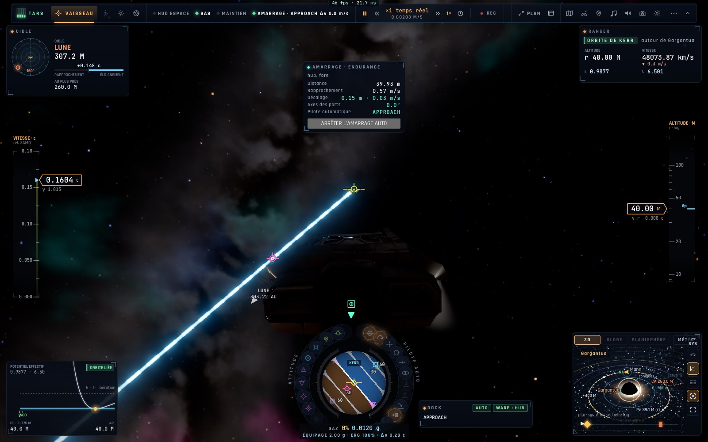

# X2d — La scène du film : l'amarrage à l'Endurance en vrille près de Mann

*2026-10-18, branche `vaisseaux-aaa` — `docs/PLAN-VAISSEAUX-AAA.md`, phase X2.*

- **La scène « Mann : l'Endurance en vrille »** : le monde de jeu de Gargantua, l'Endurance sur l'orbite de Mann (un demi
  degré derrière sa planète, hors de son attraction, la planète en vue sur la carte), **tournant sur elle-même à 3 tr/min**
  autour de l'axe de son moyeu, le Ranger à 150 m de son port avant ; le message invite à égaler sa rotation.
- **L'amarrage côté Gargantua tient compte d'une cible qui tourne** (`controller/holeendurance.ts`) :
  - l'écart de rotation (le vaisseau contre l'Endurance) au panneau et à la capture (< 3°/s, comme de notre côté) ;
  - la vitesse relative **mesurée à l'anneau** (celui du Ranger est à 1,1 m de son axe de roulis : en tournant avec
    l'Endurance il décrit un cercle) ;
  - l'autopilote (B) **vole la rotation de la cible en avance** (sinon une vrille n'est jamais rattrapée) et commande la
    vitesse du centre **moins ω × r** (et la poussée moins la traction du cercle) — sans cela l'anneau restait à 1,2 m de
    l'axe, tenu à 10 m pour toujours.
- La période de rotation de l'Endurance peut descendre sous une seconde de scène (la limite était 1 M, soit 8 minutes).

## Mesures

`tests/hole-endurance.test.ts` (4/4) : **à Mann, 18°/s d'écart au départ → B égale la rotation (0,00°/s dans les 12
derniers mètres) et s'amarre à 0,09 m/s en 265 s** ; les trois tests de X2c toujours verts. En jeu (headless) : B depuis
150 m, à 40 m en approche à 0,57 m/s, la rotation égalée, aucune erreur.

## Écarts au film et suite

- 3 tr/min et non les ≈ 67 du film : le Ranger ne tourne pas assez vite pour égaler 67 tr/min (400°/s) — à proposer comme
  défi « extrême » (X10) avec une assistance dédiée.
- La fronde autour de Gargantua ira avec la campagne Interstellar (X11).
- La carte du hub (en bas à droite) n'a pas encore ses lignes de chiffres côté Gargantua (seulement la phase).
