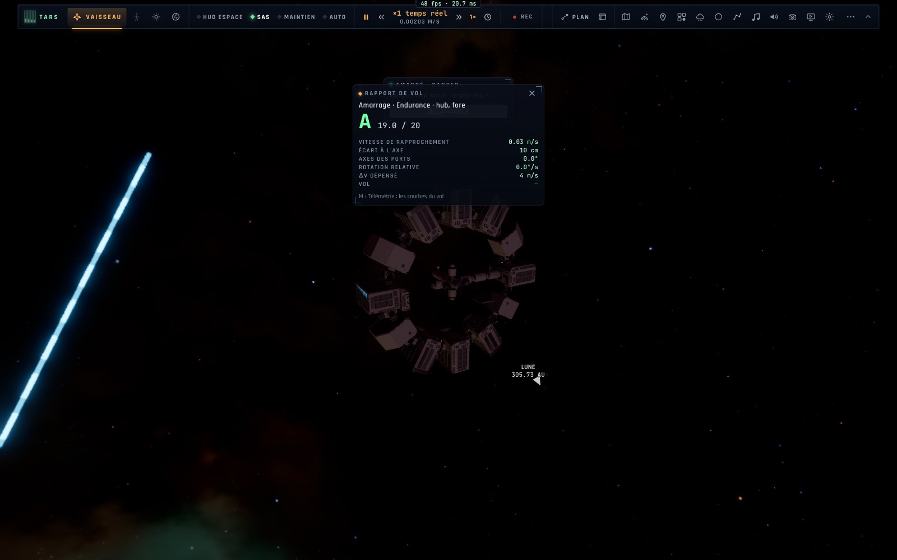

# X2e — Piloter l'Endurance près de Gargantua, traverser le trou de ver amarré

*2026-10-18, branche `vaisseaux-aaa` — `docs/PLAN-VAISSEAUX-AAA.md`, phase X2 (ses restes).*

La flotte existe maintenant **des deux côtés du trou de ver** (`controller/holeendurance.ts`, `fleet.hole`) :

- **Un vaisseau laissé près de Gargantua** suit **sa propre géodésique de Kerr**, avancée chaque image par l'intégrateur
  même du vaisseau piloté (`geodesic.ts` `advance`) — la marée entre deux vaisseaux à 150 m l'un de l'autre y vaut
  10⁻⁷ m/s² : ils restent ensemble.
- **L'amarrage y est celui de notre côté** : la capture crée **un lien de la flotte** (le vaisseau piloté emporte
  l'assemblage, sa masse comprise), plus de « tenu par la station ». L'Endurance de la scène quitte son orbite de départ
  dès qu'elle est amarrée, pilotée ou laissée : un vaisseau de la flotte comme les autres.
- **[ ]** près de Gargantua passe à un vaisseau **amarré** au vaisseau piloté ou **à moins de 10 km** (et seulement à
  ceux-là : la touche sautait au Lander, absent de ce côté) ; le vaisseau quitté continue sur sa géodésique, ou reste
  amarré au nouveau.
- **DÉSAMARRER** près de Gargantua : chaque pièce lâchée part sur sa géodésique d'où l'assemblage la tenait, le vaisseau
  piloté repoussé à 5 cm/s ; **pas de capture pendant 5 s** après (des moteurs qui retombent encore en régime ramenaient
  le Ranger aussitôt — mesuré).
- **La traversée amarrée** : les liens sont ceux de la flotte, des deux côtés — l'Endurance avec le Ranger à son moyeu
  passe de la Terre à Gargantua et revient, l'assemblage gardé ; de chaque côté les vaisseaux amarrés sont dessinés et
  se désamarrent.
- L'autopilote d'amarrage côté Gargantua reçoit l'hystérésis de notre côté (tenu en finale à moins de 20 cm, ralenti
  sous 4 cm) : à un seul seuil il oscillait entre finale et attente, l'anneau à 10 cm de l'axe.

## Mesures

`tests/hole-endurance.test.ts` (6/6) :
- le Ranger amarré (B), **[ pilote l'Endurance** (le Ranger avec elle, dessiné, le décor masqué), une poussée de ses
  moteurs, **désamarrage** : le Ranger s'écarte à 0,049 m/s sur sa géodésique ; **[ revient au Ranger**, l'Endurance
  laissée à 2 m ; **B se ré-amarre en 99 s** ;
- **à travers le trou de ver** : de la Terre, l'Endurance et le Ranger amarré posés sur un cercle de Gargantua — le
  Ranger dessiné à 14,7 m de l'origine de l'Endurance, désamarré, ré-amarré par B, puis l'assemblage reposé près de la
  Terre : l'Endurance portée avec le Ranger ;
- les quatre de X2c/X2d toujours verts (dont Mann à 3 tr/min, 0,05 m/s).

En jeu (headless, « Gargantua : le Ranger près de l'Endurance ») : B amarre (rapport A 19/20), ] passe à l'Endurance,
le Ranger amarré à son moyeu dessiné, aucune erreur.

## Limites

- Dans la gorge du trou de ver elle-même, les vaisseaux amarrés ne sont pas dessinés (ni l'un ni l'autre côté) le temps
  de la traversée.
- Un vaisseau laissé loin derrière (au-delà de 60 km) n'est plus dessiné mais continue d'être avancé ; le retrouver passe
  par la carte (son affichage sur la carte 3D viendra avec la console crew et ses cartes, K3).
