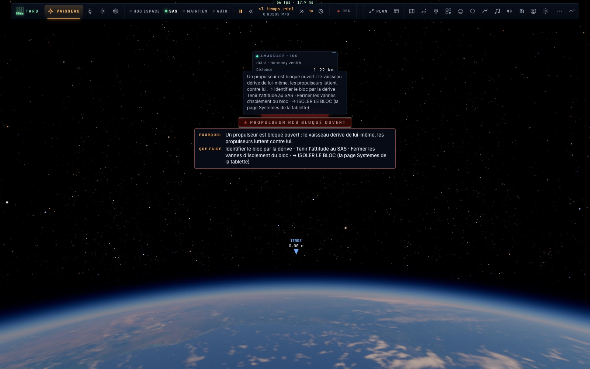
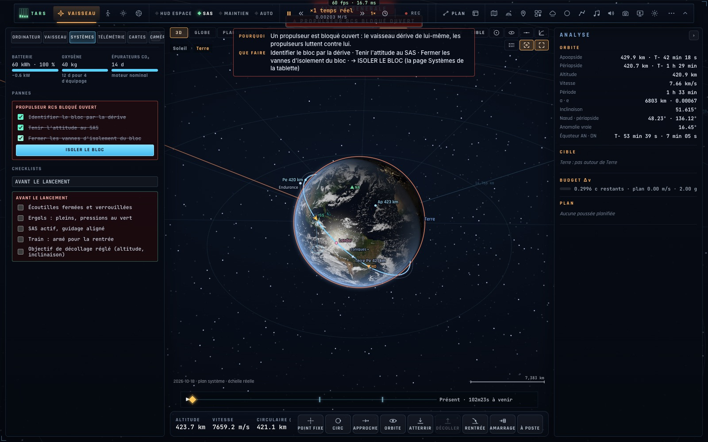

# X3 — Consommables, pannes, alarmes, checklists

*2026-10-18, branche `vaisseaux-aaa` — `docs/PLAN-VAISSEAUX-AAA.md`, phase X3.*

Les vaisseaux ont désormais des systèmes à surveiller (`game/systems.ts`, modèle pur ; `controller/systems.ts`, son
branchement au vol ; `ui/systemspage.ts`, la page **Systèmes** de la tablette) :

- **Les consommables.**
  - **L'électricité** : une batterie (Ranger 60 kWh, Lander 120 kWh, Endurance 2 MWh) nourrie par ses générateurs (piles
    à combustible, panneaux, réacteur) et tirée par les systèmes de bord, les propulseurs et les roues à réaction
    (selon l'effort).
  - **À plat**, le RCS et les roues s'arrêtent jusqu'à ce que la batterie soit rechargée à 5 %.
  - **L'oxygène** : 0,84 kg par personne et par jour, le chiffre de la NASA ; la page affiche les jours qu'il reste à
    l'équipage.
  - **Les épurateurs de CO₂**, avec leur durée de vie.
- **Les pannes.** Elles sont tirées à la cadence réglée (Réglages → Engins spatiaux → *Pannes* : aucune par défaut, rares,
  réalistes, difficiles ; jamais pour un débutant). Le générateur est graine : le même vol donne les mêmes pannes.
  - **Moteur principal éteint** : poussée nulle. Le rallumage échoue une fois sur trois, et le moteur reste alors à
    mi-poussée.
  - **Propulseur RCS bloqué ouvert** : le vaisseau dérive de lui-même. Isoler le bloc retire un quart du RCS.
  - **Dérive de la centrale inertielle** : l'attitude tenue glisse.
  - **Court-circuit du bus principal** : trois fois la consommation de bord.
  - **Fuite d'oxygène cabine** : le stock se vide en environ 6 h.
  - **Panne d'épurateur.**
- **Les alarmes.** Chaque panne allume son alarme au HUD (avertissement rouge, puis prudence ambre pendant la
  réparation), avec **POURQUOI / QUE FAIRE** : les étapes de sa checklist. S'y ajoutent les alarmes batterie basse,
  oxygène bas et épurateurs usés.
- **Les checklists.**
  - **De panne**, sur la page Systèmes : on coche chaque étape, puis l'action (« ISOLER LE BLOC », « RALLUMER LE
    MOTEUR »…) s'active et la réparation prend quelques secondes.
  - **Normales** (avant le lancement, insertion en orbite, rendez-vous et amarrage, désorbitation et rentrée, atterrissage
    propulsé), au choix dans la même page.
- **Désactivables** : *Consommables* (la batterie et l'oxygène ne baissent plus) et *Pannes* sur « aucune ».
- `__bh.camera.systemsFail(kind)` déclenche une panne (pour l'école de vol et les essais) ; `systemsInfo()` donne l'état,
  et la télémétrie le porte (`systems`).

## Mesures

`tests/systems.test.ts` (4/4) couvre :
- l'air du Ranger (40 kg pour quatre, 11,9 jours) et son bilan électrique (+1,4 kW au repos, négatif sous l'effort) ;
- le tirage graine des pannes : même graine, même vol ; environ 0,3 par heure en « réalistes » ;
- les réparations et leurs séquelles : le moteur rallumé après 30 s (à mi-poussée une fois sur trois), le bloc isolé
  (sa poussée disparaît, le RCS perd un quart de son autorité) ;
- en vol : pas de poussée avec le moteur éteint tant qu'il n'est pas rallumé, plus de rotation avec la batterie à plat,
  et les alarmes du HUD avec leur checklist.

En jeu (headless, real input) :
- la panne déclenchée à l'ISS : alarme, POURQUOI / QUE FAIRE ;
- la tablette (M), puis l'onglet Systèmes, les trois étapes cochées au clic, le bouton « ISOLER LE BLOC » ;
- la panne réparée, aucune erreur de console.

## Pas encore

- Les pannes partagées en réseau (l'Endurance commune, l'équipage à bord) : phase N.
- La console crew en affichera l'état et les checklists (K4–K6) ; l'école de vol, une leçon « panne » (X9).
