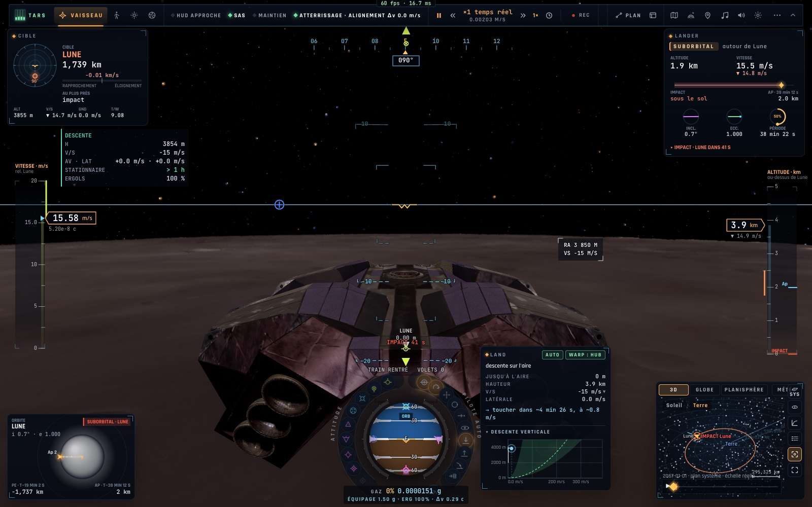
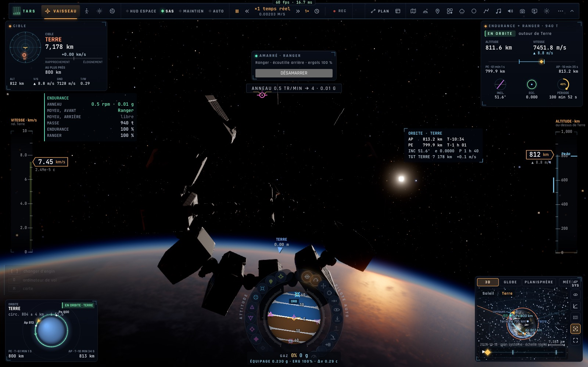

# X4 — Les HUD spécialisés des vaisseaux

*2026-10-18, branche `vaisseaux-aaa` — `docs/PLAN-VAISSEAUX-AAA.md`, phase X4.*

Chaque vaisseau a désormais son HUD, comme le F-35 son avionique (profils `VESSELS.*.space.panel`, `game/craftpanel.ts`,
`controller/craftpanel.ts`, `ui/hud/symbology.ts drawCraftPanel`) :

- **Le Lander — DESCENTE** (le module lunaire d'Apollo) : la hauteur H, la vitesse verticale, les vitesses **avant ·
  latérale** sur le sol, les **secondes de stationnaire** qui restent (le Δv du réservoir sur la pesanteur locale ; vert,
  ambre sous 60 s, rouge sous 30 s ; « > 1 h » avec le moteur fictif de certaines scènes), les ergols ; les annonces
  **« Soixante secondes »** et **« Trente secondes — posez-vous ou interrompez »**. S'affiche sous 15 km, posé exclu.
- **L'Endurance — VAISSEAU-MÈRE** : son anneau (tr/min, g), **chaque port** (libre, ou le vaisseau amarré), la masse de
  l'assemblage, les ergols de chaque vaisseau amarré.
- **Le réticule d'alignement (COAS)** des 60 derniers mètres d'un amarrage : une croix sur l'axe du port du vaisseau, le
  port visé un cercle — vert sous 1°, ambre sous 5° (dans la vue qui regarde le long de l'axe : la caméra de l'écoutille).
- **Au-dessus d'un monde sans air**, le HUD n'est plus celui d'un avion : l'espace, et l'approche sous 5 km (la descente
  lunaire montrait « HUD ATMOSPHÈRE »).
- **La carte d'amarrage côté Gargantua** a ses lignes (distance, axe · travers, rapprochement, axes des ports, rotation).
- **Les noms des ports traduits** (moyeu avant · arrière, écoutille arrière · dorsale).
- Le panneau se place avec le gestionnaire de mise en page du HUD (à gauche, sous les cartes du haut : il était d'abord
  caché sous la carte « Cible »).

## Mesures

`tests/craftpanel.test.ts` (4/4) : secondes de stationnaire (162 m/s à 1,62 m/s² = 100 s), tons, annonces à 60 et 30 s ;
le panneau vaisseau-mère (anneau, ports, masse, ergols) ; le choix du HUD sans air ; en vol : le Lander à 3 km de la Lune
→ DESCENTE, l'Endurance avec le Ranger amarré → ENDURANCE, « moyeu, avant : Ranger ». Tests voisins (HUD, i18n,
Gargantua, protections, LPD, anneau) 31/31. En jeu (headless) : la descente du Lander (HUD d'approche, panneau à gauche),
l'Endurance en orbite (son panneau), aucune erreur.

## Pas encore

- Couleur et luminosité réglables du HUD des vaisseaux (comme le HMD du F-35) ; la boule de navigation « AAA ».
- Les écrans de bord (cockpits) reprendront ces panneaux (X6).
