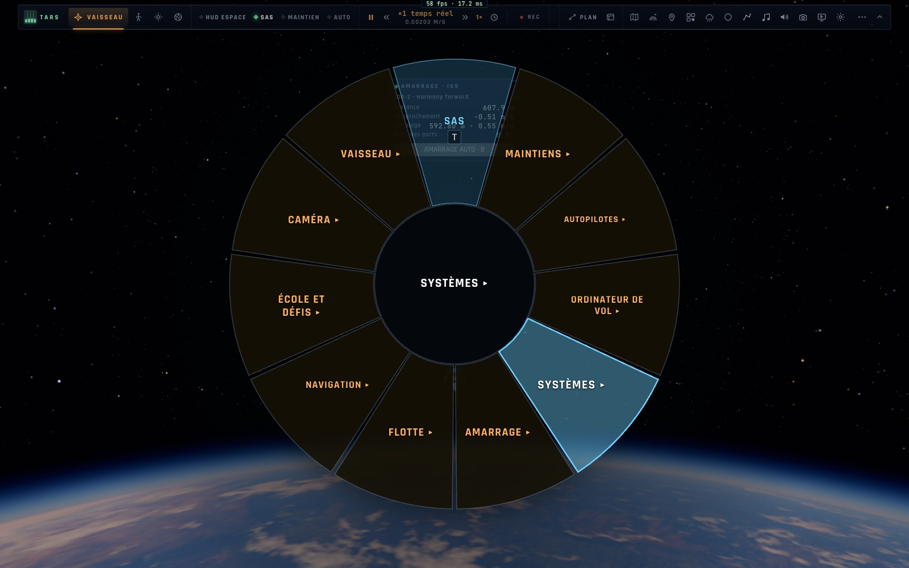
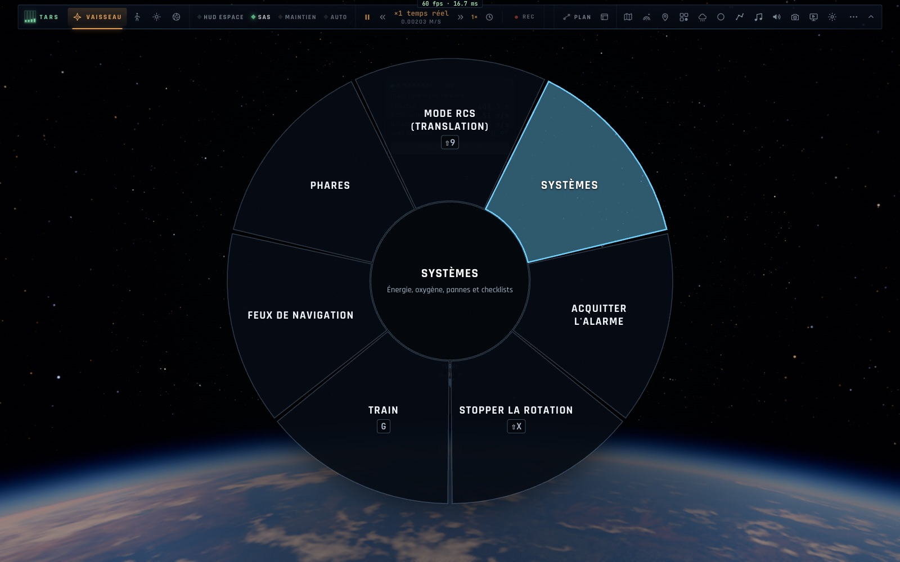

# X5 — La roue, la manette, le HOTAS des vaisseaux

*2026-10-18, branche `vaisseaux-aaa` — `docs/PLAN-VAISSEAUX-AAA.md`, phase X5.*

- **La roue du vaisseau** (Tab maintenu ; `ui/spacewheel.ts`, pure, construite à chaque ouverture selon l'appareil et
  son état) a onze secteurs :
  - **SAS**.
  - **Maintiens ▸** : les neuf maintiens et le manuel.
  - **Autopilotes ▸** : tous ceux de l'appareil — circulariser, exécuter le nœud, transfert, approche, orbiter la
    cible, rendez-vous et amarrage, maintien à poste ; stationnaire, descente et décollage pour ceux qui se posent ;
    rentrée pour le Ranger.
  - **Ordinateur de vol ▸** : ORBITE, CIBLE, ATTERRIR, MISSION, le plan de mission (⇧O), exécuter.
  - **Systèmes ▸** : mode RCS, la page Systèmes (X3, le nombre de pannes en cours), acquitter, stopper la rotation,
    train, feux, l'**anneau ±** de l'Endurance.
  - **Amarrage ▸** : amarrer ou maintien à poste ; amarré : désamarrer, faire le plein, désamarrer et tenir à 30 m ;
    cible suivante.
  - **Flotte ▸** : les vaisseaux qu'on peut piloter (côté Gargantua : ceux qui sont là).
  - **Navigation ▸**, **École et défis ▸**, **Caméra ▸**.
  - **Vaisseau ▸** : l'assistance (manuel, réaliste, assisté, débutant), le mode de vol, le HUD, les commandes fines.
- **Chaque appareil a la sienne** : l'Endurance a son anneau et ni train ni atterrissage ; le Lander a sa descente.
  Les entrées avion (plan de vol, ILS, carte de mission) ne reviennent que si le Ranger vole en mode avion.
- **La manette vaisseau** (`input/spacepad.ts`, comme `jetpad.ts` pour le F-35) :
  - **Manche gauche** : tangage et lacet ; en translation RCS, haut, bas, gauche, droite.
  - **Gâchettes** : les gaz ; en translation, avant et arrière. **LB · RB** : le roulis. **L3** : le mode RCS.
    **Manche droit** : le regard.
  - **A** : le SAS. **B** : acquitter, maintenu stopper la rotation. **X** : amarrer, maintenu le maintien à poste.
  - **Y maintenu ouvre la roue** : le manche droit vise, A fait le secteur, B revient, Y relâché fait le secteur.
  - **Croix** : prograde, rétrograde, vers la cible, radial et normal tour à tour.
  - **View** : la vue, maintenu la carte. **Menu** : le menu pause, maintenu le plan de mission.
  - Une feuille d'aide « Un vaisseau à la manette » est dans l'aide des touches.
- **HOTAS** : bouton « Profil vaisseau 6 DDL » dans l'écran Manettes (`spaceTemplate`).
  - Sur une manette standard : la disposition d'amarrage (manche droit l'attitude, manche gauche les translations,
    gâchettes avant et arrière).
  - Sur une manette des gaz : son basculeur fait la translation avant–arrière au lieu du palonnier ; le mini-manche
    garde les translations latérales.

## Mesures

`tests/spacepad.test.ts` (5/5) couvre :
- les manches ;
- les boutons, tapés ou maintenus ;
- la roue à la manette (vol coupé pendant qu'elle est ouverte, visée, A, B, Y relâché) ;
- la roue de chaque appareil (onze secteurs, dix maintiens, anneau de l'Endurance, descente du Lander, amarré, mode
  avion) ;
- le profil 6 DDL.

Tests manettes, HOTAS, touches et i18n : 95/95.

`tests/e2e/vaisseaux-x5.e2e.test.ts` (4/4, headless, real input) :
- Tab maintenu, puis Autopilotes ▸ Maintien à poste cliqué ;
- le sous-menu Systèmes ▸ de l'Endurance avec son anneau ;
- avec une manette factice : A, ▲, L3, puis Y maintenu, visée au manche, A, B, Y relâché.

`smoke` (17/17, sa roue passe maintenant par Maintiens ▸) et `pad` (2/2, Menu ouvre toujours la pause) passent aussi.

## Pas encore

- La roue *Flotte* donnera les ordres aux autres joueurs (demande d'amarrage, « tiens ta position », rendez-vous) :
  phase N.
- La fronde (X11) rejoindra les autopilotes.
