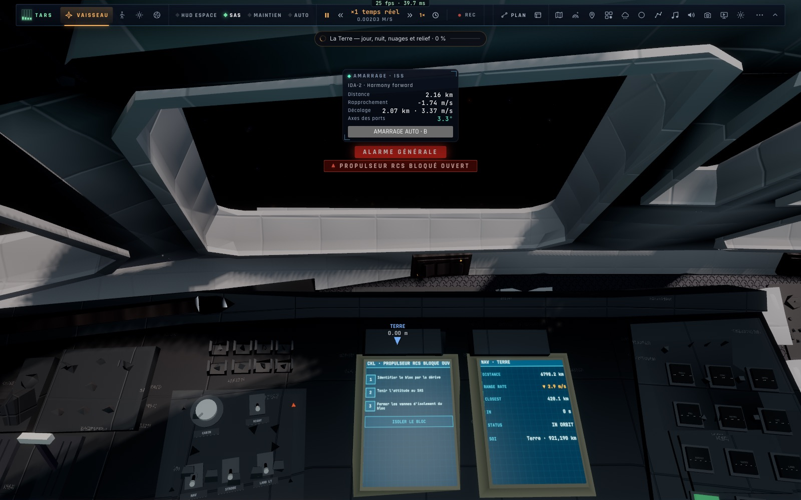
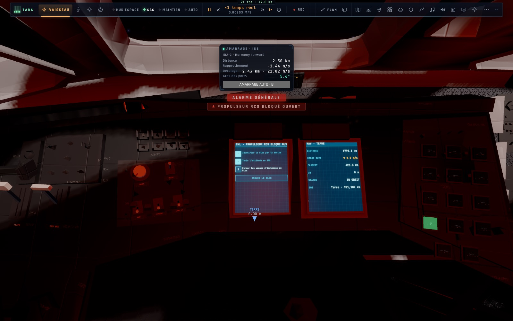
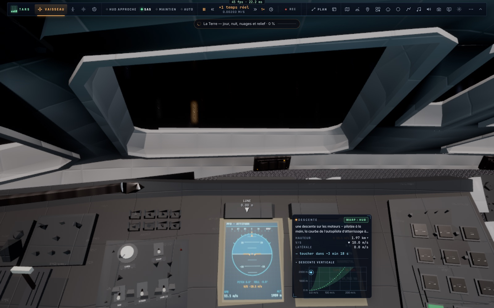
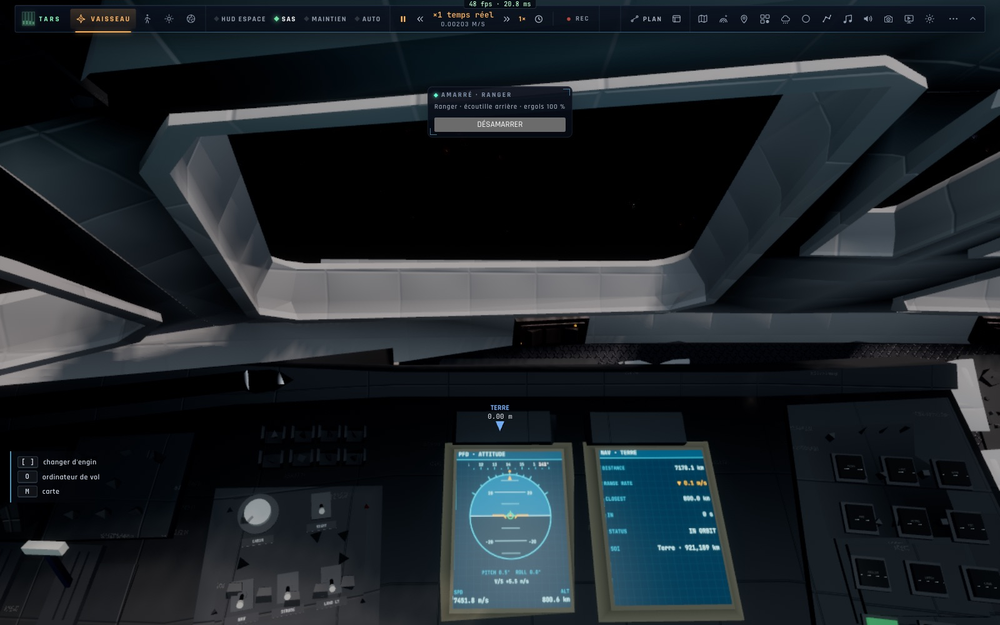

# X6 — Les cockpits

*2026-10-18, branche `vaisseaux-aaa` — `docs/PLAN-VAISSEAUX-AAA.md`, phase X6.*

## X6a — Le Ranger : des écrans tactiles, deux boutons de plus

- **Deux nouvelles pages** sur les écrans de bord (`ui/cockpitscreens.ts`) :
  - **CKL** : la checklist de la panne en cours, une étape par bouton qu'on touche, puis l'action, donnée seulement
    quand toutes les étapes sont cochées. Sans panne, les checklists normales des phases de vol, avec un bouton
    « CHECKLIST SUIVANTE ». Les cases sont les mêmes que sur la tablette et dans la console crew (`camera.sysTicks`) ;
  - **ECS** : batterie, oxygène, épurateurs, bilan électrique, équipage, pannes en cours.
- **Des écrans tactiles, comme le PCD du F-35.** Les pages dessinent des boutons et gardent leurs zones ; un toucher
  sur l'écran fait l'action (`actAt`). Les onglets restent prioritaires quand ils sont affichés. La page SYS a ses
  boutons **SAS · RCS TR · PRO · RETRO**. La barre d'onglets passe à 2 × 6.
- **Deux boutons physiques** sur le panneau C, sous l'autopilote :
  - **RCS TRANS** : le mode translation, allumé en ambre quand il est actif ;
  - **MASTER** : l'alarme principale, qui clignote en rouge tant qu'une panne est en cours ; un appui l'acquitte.
- L'éclairage de nuit existant s'applique aux nouvelles pages (capture).

## X6b–c — Le Lander et l'Endurance : la cabine du film

Le modèle de la cabine du Ranger s'appelle *endurance lander cockpit* : dans le film, les trois vaisseaux partagent
cet intérieur.
- Chaque profil de vaisseau peut maintenant porter une **cabine décalée** (`VESSELS.*.cabin.offset`). Le Lander l'a
  derrière les hublots de son nez, l'Endurance dans le module de commande de son moyeu. L'œil du pilote se place sur
  le point de vue « Cockpit » de chacun, et le regard garde la même direction.
- `ship.ts` dessine la cabine à son décalage. Le pointeur et les projections (commandes cliquables, écrans tactiles)
  passent dans le repère de la cabine (`cabinRay`, `cabinProject`).
- Les écrans montrent les données du vaisseau piloté (la descente du Lander, l'Endurance avec le Ranger amarré).

## Mesures

- `tests/cockpit-pages.test.ts` (3/3) : les onglets en 2 × 6. Sur la page CKL, le toucher d'une étape donne `tick` ;
  le bouton d'action n'a pas de zone tant que la checklist est incomplète, puis donne `fix`. Le bouton SAS de la page
  SYS est testé aussi.
- `tests/cabin.test.ts` : l'œil du pilote décalé tombe sur le cockpit du Lander et de l'Endurance, regard compris.
- Tests cockpit (contrôles, état, pointeur, lumières) : 16/16.
- En jeu (headless) : les pages CKL et ECS dans le cockpit du Ranger, de jour et de nuit ; les cockpits du Lander
  (au-dessus de la Lune, PFD à 1 959 m) et de l'Endurance (Ranger amarré) ; aucune erreur.

## Pas encore

- **Un tableau propre au Lander** (hublots de descente, grille du désignateur gravée sur le hublot) et **une
  passerelle propre à l'Endurance** (sièges, consoles, TARS/CASE) : deux modèles à construire sous Blender, ou un
  modèle CC-BY à télécharger. Je proposerai le modèle avant tout téléchargement.
- **Le second siège pour un passager en réseau** : phase N.
- **Le coût GPU** n'a pas été mesuré. Pour l'Endurance, la cabine remplace sa coque, bien plus lourde : le coût ne
  peut que baisser.
