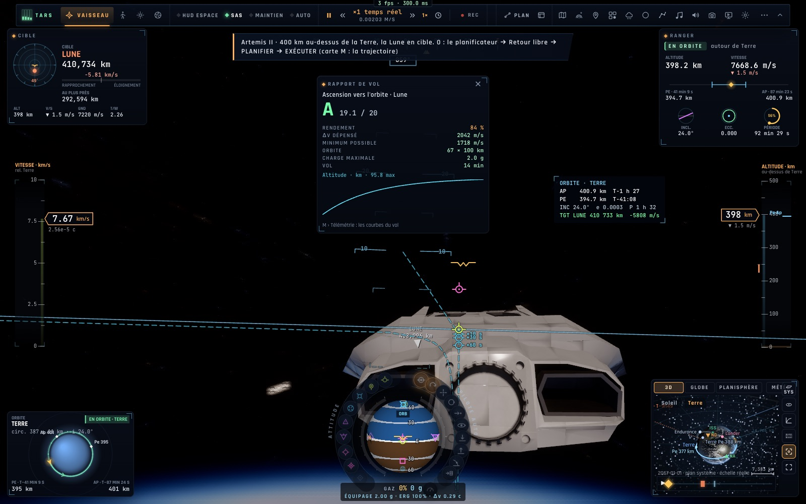

# X8 — Télémétrie, comptes rendus, horloges

*2026-10-18, branche `vaisseaux-aaa` — `docs/PLAN-VAISSEAUX-AAA.md`, phase X8.*

- **Les canaux du vaisseau** dans l'enregistreur de vol (page TÉLÉMÉTRIE de la tablette, CSV, graphiques de TARS) :
  Δv restant, Δv du plan, batterie, oxygène, distance et vitesse d'amarrage, temps écoulé sur Terre au-delà du temps
  du vaisseau. Ils restent vides pour le F-35.
- **Les comptes rendus /20 par phase** (`game/report.ts`), donnés à la fin de chaque phase par un observateur
  (`controller/phasereports.ts`, appelé chaque image avec le statut du vol) :
  - **ascension** : le rendement, c'est-à-dire le Δv minimal (écart d'énergie entre le sol tournant et l'orbite)
    sur le Δv dépensé. 20/20 dès 85 %. On y lit aussi l'orbite atteinte et la charge maximale ;
  - **insertion** : la précision de l'orbite atteinte. La visée est l'objectif de lancement après un décollage
    automatique, ou l'apoapside au début de CIRC. L'inclinaison compte quand elle était visée ;
  - **rendez-vous** : le Δv dépensé contre celui du plan, et le temps ;
  - **rentrée** : le couloir (charge et flux thermique maximaux) et l'écart au site visé ;
  - l'atterrissage et l'amarrage gardent leurs comptes rendus existants.
- **Le débrief à graphique** : la carte de compte rendu montre la courbe de la phase (l'altitude de l'ascension, la
  charge de la rentrée, le Δv du rendez-vous), tirée de l'enregistreur.
- **Les horloges** : l'écran CLOCKS du cockpit montre le **MET** (temps de mission) d'un vaisseau. Il affiche aussi
  **TERRE +…** quand l'horloge de la Terre a pris de l'avance sur celle du vaisseau (les heures de Miller : rouge
  au-delà d'un jour). Le journal de bord inscrit chaque compte rendu, comme avant.

## Mesures

`tests/phase-reports.test.ts` (3/3) :
- le Δv minimal vers l'orbite : 7,6 à 8,2 km/s pour 400 km depuis Kourou, 1,6 à 1,8 km/s pour 100 km depuis la Lune ;
- les notes de chaque phase, bonnes et mauvaises ;
- **en vol** (le contrôleur réel) : le Ranger décolle de Tranquillité vers 100 km en autopilote. Résultats :
  - « Ascension vers l'orbite · Lune : 19,1 », rendement 84 %, 2 042 m/s pour un minimum de 1 718 ;
  - puis « Mise en orbite : 20,0 », orbite 100,1 × 101,0 km pour 100 km visés.
  Au premier essai, l'insertion était jugée au milieu de la circularisation (Pe −36 km) : elle attend maintenant la
  fin de la séquence de décollage.

En jeu (headless) : la carte de compte rendu avec sa courbe, aucune erreur. La capture reprend les valeurs du vol de
test, injectées dans la carte.

## Pas encore

- Les comptes rendus partagés dans la salle (un classement par épreuve) et envoyés au crew : phase N.
- Le graphique de débrief façon instructeur F-35 (idéal, couloir, vol) : la courbe seule pour l'instant.
