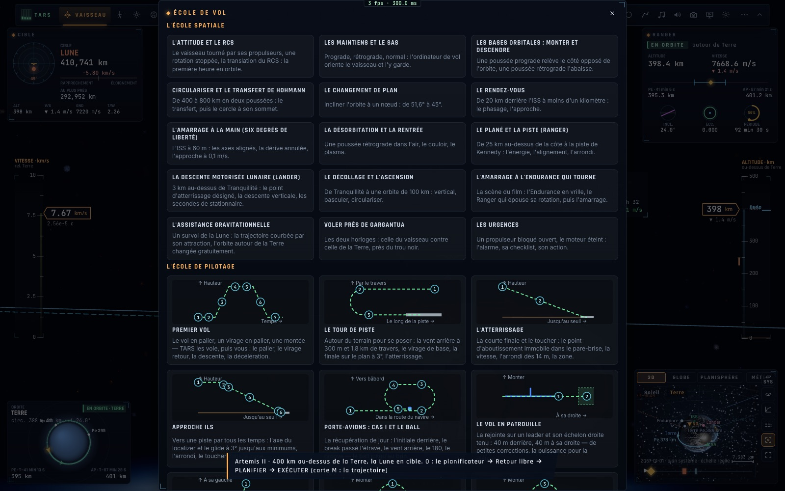
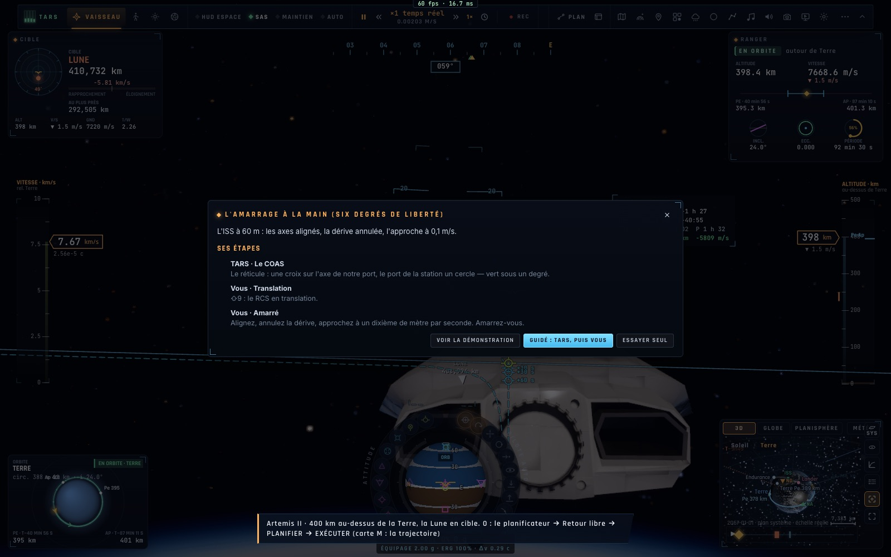

# X9 — L'école de vol spatial

*2026-10-18, branche `vaisseaux-aaa` — `docs/PLAN-VAISSEAUX-AAA.md`, phase X9.*

- **Quinze leçons** (`game/spacecourse.ts`), chacune avec sa mise en place (une scène, une orbite, un sol, un
  stationnaire, l'ISS à une distance donnée, une cible) :
  1. l'attitude et le RCS ;
  2. les maintiens et le SAS ;
  3. monter et descendre ;
  4. circulariser et le Hohmann ;
  5. le changement de plan ;
  6. le rendez-vous ;
  7. l'amarrage à la main en 6 degrés de liberté ;
  8. la désorbitation et la rentrée ;
  9. le plané et la piste (Ranger) ;
  10. la descente lunaire avec le désignateur (Lander) ;
  11. le décollage et l'ascension ;
  12. l'amarrage à l'Endurance en vrille (la scène du film) ;
  13. l'assistance gravitationnelle (un survol de la Lune) ;
  14. voler près de Gargantua (les deux horloges) ;
  15. les urgences (RCS bloqué, moteur éteint).
- **Trois façons de prendre une leçon** :
  - **guidé** : TARS vole ses étapes et les dit, puis vous laisse les commandes ;
  - **démonstration** : TARS vole aussi vos étapes, avec ses propres mots (« Je le fais : … ») ;
  - **essai** : vos étapes seules.
- **Les étapes.** Une étape est faite quand ce qu'elle demande tient un instant : maintien aligné à moins de 5°, Ap
  ou Pe atteinte, orbite circulaire, inclinaison, amarré, posé, à moins d'un kilomètre de la cible, panne réparée,
  point désigné, rotation arrêtée, nez tourné de 90°, translation faite, événement de la trajectoire. Sinon elle
  passe à la fin de son temps : c'est le garde-fou, une leçon ne bloque jamais.
- **Le compte rendu de leçon** : 20 partagés entre vos étapes faites ; chacune avec son temps, ou « temps écoulé ».
- **Le moteur** (`controller/spacecourse.ts`) lit chaque image les chiffres du vol, et fait ses actes : SAS,
  maintiens, autopilotes (dont le rendez-vous B), mode RCS, pannes et réparations, vrille, ⇧X. Les actes qui ont
  besoin des outils du jeu (manœuvre planifiée, mission, exécution, accélération du temps, objectif de lancement)
  passent par la page.
- **L'école** (la roue, « École de vol ») présente l'**école spatiale en premier** dans un vaisseau, puis l'école de
  pilotage. Chaque leçon a sa carte (étapes de TARS et les vôtres) et ses trois boutons.
- **La base de connaissances de TARS** (`docs/spatial/{en,fr}`, outil `knowledge`) gagne six pages : orbites,
  manœuvres, rendez-vous et amarrage, rentrée et atterrissage, systèmes et urgences, relativité.
- Français : `src/i18n/fr-spaceschool.ts` (143 phrases ; un test vérifie qu'aucune ne manque).

## Mesures

- `tests/spacecourse.test.ts` (5/5) :
  - quinze leçons, chaque étape du pilote avec sa démonstration et son garde-fou ;
  - les conditions des étapes ;
  - un déroulé guidé où une étape tombe en temps écoulé : 13,3/20 ;
  - le français complet ;
  - **en vol** (le contrôleur réel) : la leçon « Les maintiens » démontrée en orbite basse, TARS volant chaque
    étape. Résultat : 20/20 (rétrograde en 6 s, normal en 4 s, relâcher en 2 s).
- `tests/knowledge.test.ts` (3/3) : 17 pages par langue. Les questions spatiales (« Hohmann », « fuite d'oxygène »,
  « dτ/dt »…) trouvent leur section.
- `tests/e2e/space-school.e2e.test.ts` (1/1, clics réels) : l'école ouverte dans un vaisseau, 15 leçons spatiales en
  premier ; la carte « Les maintiens », puis la démonstration jusqu'à son compte rendu « 20,0 / 20 ».

## Pas encore

- Les **schémas** des leçons spatiales (comme les diagrammes des leçons d'avion) et un instructeur à canaux par leçon.
- La **leçon à deux** en réseau (moniteur et élève) : phase N.
- Seule « Les maintiens » est vérifiée de bout en bout. Les démonstrations longues (Hohmann, plan, rentrée, fronde)
  s'appuient sur les autopilotes existants et le garde-fou ; une campagne qui les vole toutes reste à faire.
